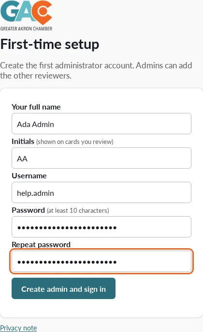
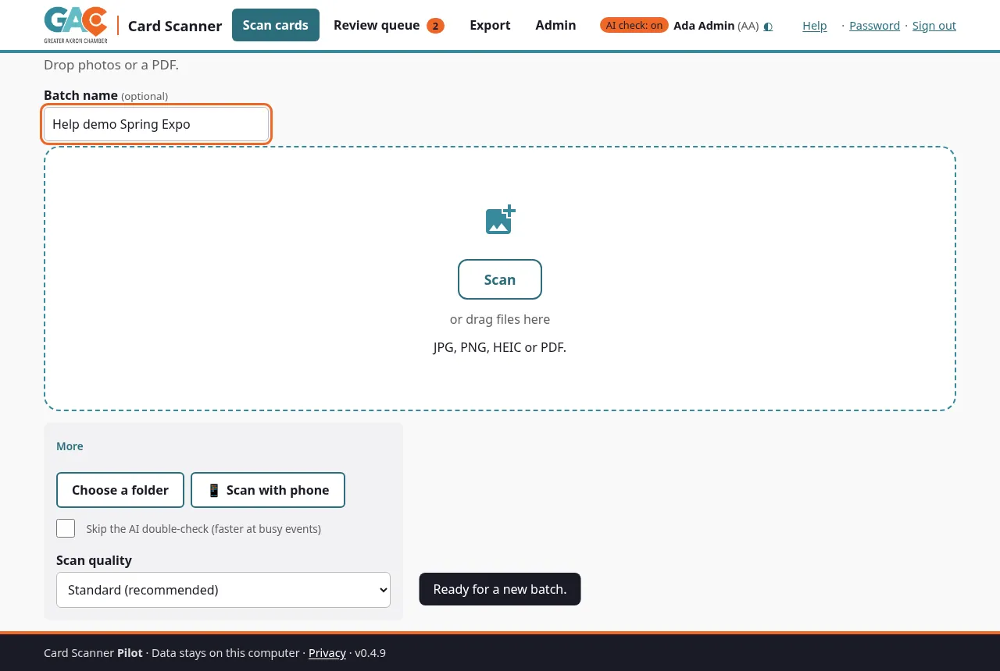
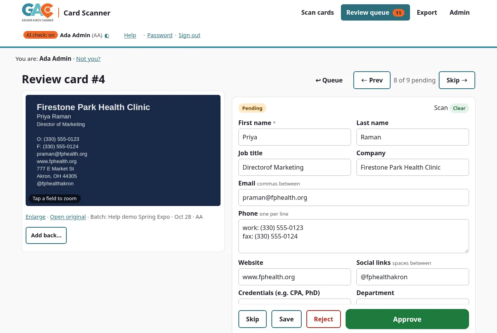
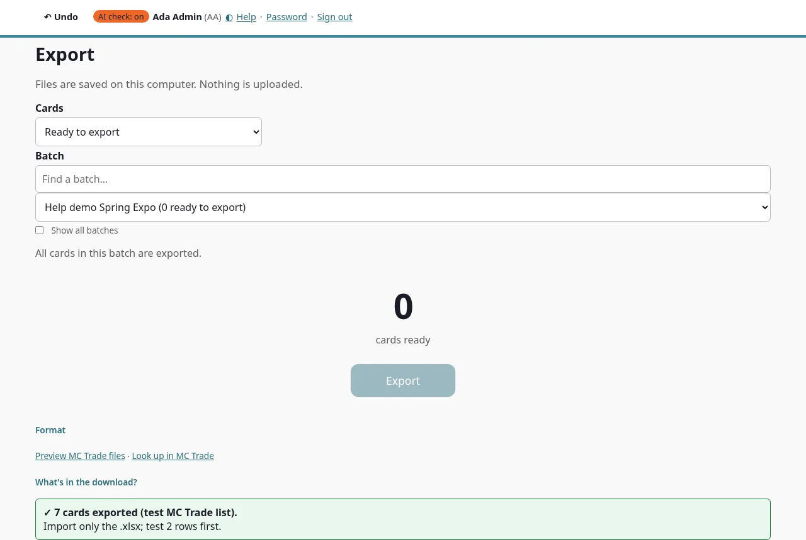

# Card Scanner: Quick start
*Greater Akron Chamber*

The Card Scanner turns photos of business cards into a contact list you can check and import into MC Trade. Everything runs on one office computer. Card photos and contact details are **never sent to the internet**.

---

## 1. Start the scanner (the person who looks after it)

**You need:** a Windows 10/11 (64-bit) PC or a Mac (macOS 14 or newer), and about 5 minutes. Nothing else to install: the app includes the card-reading engine.

1. **Download the installer** for your computer from https://github.com/LynyrdGrynyrd/gac-card-scanner/releases/latest:
   - **Windows:** `GAC-Card-Scanner-Setup-x.y.z.exe`
   - **Mac with Apple silicon (M1-M4):** `GAC-Card-Scanner-x.y.z-macos-arm64.dmg`; **Mac with Intel:** `…-macos-x86_64.dmg`
2. **Install it.**
   - **Windows:** double-click the setup file. If a blue **"Windows protected your PC"** box appears, click **More info → Run anyway** (the installer isn't code-signed yet). No administrator rights needed.
   - **Mac:** open the `.dmg` and drag **GAC Card Scanner** onto **Applications**. The first time only, right-click the app in Applications, choose **Open**, then **Open** again.
3. Open **GAC Card Scanner** (Start menu / Applications). It opens in its own window. The first time, it asks you to **create the admin account**.

4. Go to **Admin → Reviewers** and add an account for each person on the data team. Give each person their username and temporary password; they choose their own password at first sign-in.

**Other ways to run it** (for IT; most offices don't need them): from the source code with `start.command` (Mac) / `start.bat` (Windows), which need Python 3.12 and Tesseract installed, or with Docker. See README.md ("Developer install", "Run with Docker"). Then the scanner is at **http://localhost:8765** in your browser, and the black window must stay open while you work.

Backups: while it runs, the app makes a backup every night (or about 10 minutes after it starts, if it missed one) into a folder next to its data folder (Windows: `%LOCALAPPDATA%\GAC Card Scanner Backups`; Mac: `~/Library/Application Support/GAC Card Scanner Backups`). Copy that folder to another drive now and then.

## 2. Scan cards (anyone with an account)

1. Open the **GAC Card Scanner** app (or, for a shared install, the address IT gave you) and sign in.
2. Optional: type a **batch name**, for example "Oct 15 Business After Hours".
3. Drag photos (or a whole folder of photos) onto the dashed box, or click **Choose photos** or **Choose a folder**.
4. Watch each card being read. Cards marked **Check** need a second look; **Not added** files show the reason (blank photo, not a photo, or already scanned).
   An **already scanned** photo says who scanned it and when. If you really want a second copy, click **Scan it anyway** on that row.
   The header count, the queue and the "already scanned" check are shared by everyone on the team.

## 3. Review and approve

Click **Review this batch**. Open each card, compare the fields with the photo, fix anything wrong, then **Approve** (key **A**) or **Reject** (key **R**). **J**/**K** move to the next and previous card, and **U** undoes your last action.

- **Yellow** fields were hard to read: check them against the photo.
- **First name is required.** A blank first name, an email without "@" or a phone with fewer than 7 digits can't be approved, not even with "Approve anyway". All problems are listed together.
- The optional **AI double-check** takes about 45 seconds of AI model time per card (median of 48 measured checks; 9 in 10 within about 75 seconds), plus any wait in the AI line: cards are checked one at a time, so with others ahead it takes longer (the card shows its place in line). It checks the saved card, so save first. If it is busy the box says so, and you don't need to wait for it. It never changes what you typed: it offers suggestions you accept or keep.
- **"from QR code"** means the detail came from the card's QR code, which is very reliable.
- An **orange box** means the person may already be in MC Trade or scanned twice. Pick one of the plain-language choices.

## 4. Export for MC Trade

Go to **Export**, keep **"Approved, not yet exported"**, choose your event in **Batch** (otherwise every batch is exported), and click **MC Trade import (Excel)**. The file name includes the batch. Your **Downloads** folder gets **the import file** `GAC-MCTrade-….xlsx` (this is the file you import in MC Trade: template columns only, one row per person), a `…-READ-ME.txt`, a `…-extra-columns.csv` (notes, second emails, rows left out; not for import) and, when some cards update existing MC Trade profiles, `GAC-MCTrade-…-UPDATES.xlsx` (a separate import). Read the READ ME first. **Check against MC Trade (dry run)** on the same page shows UPDATE / CREATE / NEEDS REVIEW per card without changing anything. The header row comes from GAC's template once an admin uploads it (Admin → Settings; saved as `data/mctrade_template.xlsx`).

## Using a phone (optional)
Phones can scan cards directly with the camera. Use **Scan cards → Scan with phone** in the scanner and scan the QR code with a phone on the same office Wi-Fi (no certificate or extra step; see docs/PHONE-MODE.md). The old `enable-phone-access` scripts are retired. Under Docker, phone mode doesn't work as shipped (see docs/PHONE-MODE.md).

## Help
- **Forgot password:** ask an admin (Admin → Reviewers → Reset password).
- **Nobody can sign in:** see "Locked out" in DATA-TEAM-GUIDE.md.
- **Something looks wrong:** take a screenshot and note the card number (#).
