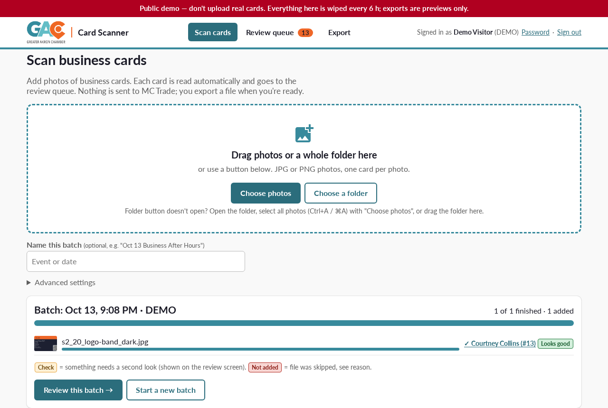
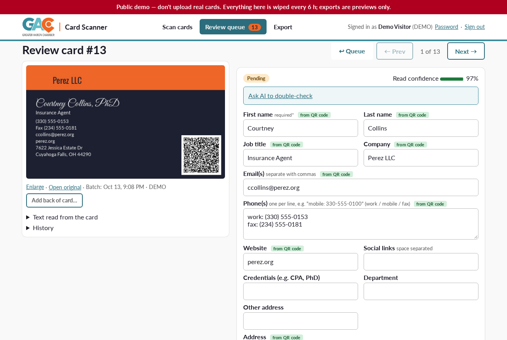
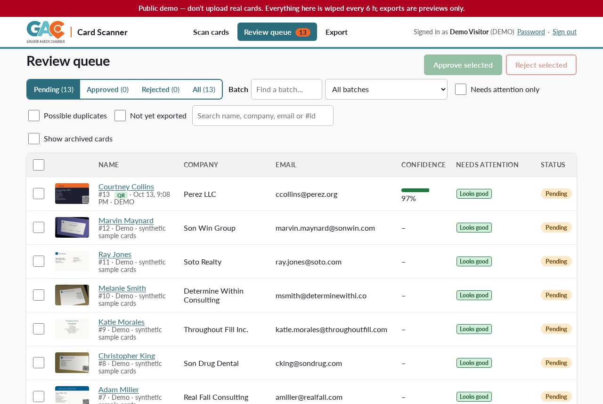
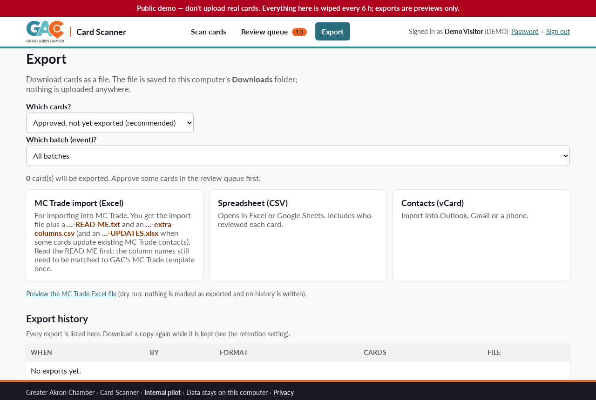
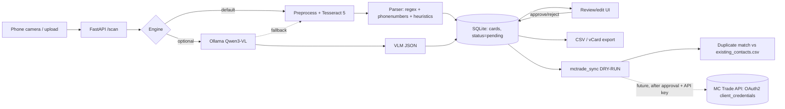

# GAC Card Scanner

Photograph a pile of business cards after an event, check each one in a clean review screen, and export a contact list ready to import into a CRM. Built for the **Greater Akron Chamber** (GAC) data team as a pilot; it produces import files in the layout of **MC Trade** (MemberClicks), the Chamber's member database.

- **Local and CPU-only.** OCR (Tesseract 5 + RapidOCR/PP-OCR), QR/vCard decoding (zxing-cpp) and a rules parser (phonenumbers, name lexicon) run on one ordinary computer. No cloud calls; card photos and contacts stay on the box.
- **Human review first.** Every card lands in a review queue with per-field confidence, look-alike/duplicate warnings against the existing CRM and within the batch, plausibility hints and an audit history. Nothing is exported until a reviewer approves it.
- **Exports:** CSV, vCard, and an MC Trade import Excel (new profiles, separate updates file, one row per person). A *dry-run* sync shows what would be created or updated; there is no live CRM write.
- **Optional AI double-check:** a local vision model (Qwen3-VL-4B-Instruct GGUF via llama.cpp) re-reads low-confidence cards; scanning works without it.
- Sign-in with named reviewers and admin roles, CSRF protection, photo/export retention, delete-on-request.

**Live demo:** DEMO_LINK_PLACEHOLDER (Hugging Face Space, synthetic cards only; see [Public demo](#public-demo))

| Scan a batch | Review a card |
|---|---|
|  |  |
| **Review queue** | **Export** |
|  |  |

*Screenshots are from the public demo mode with synthetic cards (fictional people, 555 phone numbers).*

## Run locally
```bash
sudo apt-get install -y tesseract-ocr        # macOS: brew install tesseract
git clone <this repo> gac-card-scanner && cd gac-card-scanner
python3 -m venv .venv && .venv/bin/pip install -r requirements.txt   # exact tested versions: requirements.lock.txt
.venv/bin/uvicorn app.main:app --host 127.0.0.1 --port 8765
# open http://localhost:8765 and create the first admin (first-run setup only works from this computer)
```
`start.command` (macOS) / `start.bat` (Windows) do the same with a double-click. Staff docs: [QUICKSTART.md](QUICKSTART.md), [DATA-TEAM-GUIDE.md](DATA-TEAM-GUIDE.md); developers: [HANDOFF.md](HANDOFF.md).

Try the demo mode locally (synthetic cards, shared login, nothing kept):
```bash
GAC_DEMO=1 .venv/bin/uvicorn app.main:app --host 127.0.0.1 --port 8765   # login: demo / try-the-demo-2026
```
Demo mode uses the normal `data/` folder and **wipes it** (cards, photos, exports) at start: use a separate checkout, never your real install.

## Run with Docker
```bash
docker compose up -d            # http://localhost:8765 (published on 127.0.0.1 only); data in a named volume
# or
docker build -t gac-card-scanner . && docker run -p 127.0.0.1:8765:8765 -e GAC_ALLOW_REMOTE_SETUP=1 -v gac-data:/srv/gac/data gac-card-scanner
```
HTTPS: mount a certificate at `/srv/gac/certs/cert.pem` + `key.pem` (see HANDOFF.md). The demo image for Hugging Face is `Dockerfile.space` (below).

## Public demo
`GAC_DEMO=1` turns the app into a shared public demo (used by the Hugging Face Space):
- red banner on every page: **"Public demo — don't upload real cards"**; one shared demo login is printed on the sign-in page (`GAC_DEMO_USER` / `GAC_DEMO_PASSWORD`)
- synthetic sample cards are seeded (from `tests/synth2`); setup, password changes and all admin calls are refused
- every export is a **preview** (MC Trade Excel = dry-run file); nothing is stored or marked exported
- uploads are capped (`GAC_DEMO_MAX_MB`, default 5 MB per photo; `GAC_DEMO_MAX_CARDS`, default 60) and **everything is wiped every `GAC_DEMO_WIPE_HOURS` (default 6) hours**, then re-seeded
- no audit of visitors: no IP addresses in sessions or the sign-in log; the corrections dataset is off

The Space image (`Dockerfile.space`, `space/start.sh`, `space/README.md`) runs on the free CPU tier, downloads Qwen3-VL-4B-Instruct GGUF (Apache-2.0) from Hugging Face at start and runs `llama-server` with 2 threads; if the download or the server fails, the demo runs rules-only. `GAC_RULES_ONLY=1` skips the model. How to publish: [PUBLISH.md](PUBLISH.md).

## Privacy
Business cards carry personal data. In a real install everything stays on the computer running the scanner: no telemetry, no cloud OCR, no CRM writes. Photos and stored exports are purged after a retention period (admin setting), a card can be deleted on request, and the review history keeps no personal data after deletion. See [PRIVACY-NOTE.md](PRIVACY-NOTE.md).

**This repository contains no real personal data.** All test, demo and screenshot cards are generated (`tests/gen_cards.py`, `tests/gen_hard.py`, `tests/gen_synth2.py`) with fictional people and 555 numbers; `data/existing_contacts.csv` is a fake CRM sample. The pilot's real-card benchmark, QA screenshots, logins, database and exports were left out. **Don't upload real cards to the public demo.**

## Tests
```bash
.venv/bin/pip install pytest httpx
.venv/bin/python -m pytest tests/unit          # unit + API tests, incl. tests/unit/test_demo.py (demo mode)
.venv/bin/python tests/gen_cards.py && .venv/bin/python tests/gen_hard.py && .venv/bin/python tests/eval.py   # synthetic accuracy
```
Synthetic cards are far easier than real ones; budget for human review on every card.

## Developer reference
### Endpoints
> Since the /ui release, `/`, `/queue`, `/card/{id}` and `/export.*` redirect to `/ui` and require sign-in. See HANDOFF.md.

| Path | Purpose |
|---|---|
| `/ui` | Data-team web app (scan, review queue, review card, export, admin) |
| `/login`, `/setup`, `/privacy` | Sign-in, first-run admin setup, privacy note |
| `/api/...` | JSON API used by /ui (sign-in required; see app/ui.py, app/auth.py) |
| `/img/{name}` (`?w=160` for a cached thumbnail) | Card photo (sign-in required) |
| `POST /api/scan` | JSON API for scanning one image (capped by `SCAN_WORKERS`) |
| `/health` | Liveness check |

Retired (redirect to /ui or 410): `/`, `/card/{id}`, `/queue`, `/export.*`, `/sync/dry-run*`.

### Architecture

Files: `app/ocr.py` (engines), `app/parser.py` (fields+confidence), `app/store.py` (SQLite queue), `app/export.py`, `app/mctrade_sync.py` (stub), `app/main.py` (web UI), `data/existing_contacts.csv` (fake CRM sample), `tests/` (synthetic cards, ground truth, eval).


## License
**GPL-3.0-or-later** (see [LICENSE](LICENSE)). GPL was chosen because the first-name lexicon dependency, [gender-guesser](https://github.com/lead-ratings/gender-guesser), is GPL-3.0. The Greater Akron Chamber name and logo are not covered by the license; replace them in a fork.

## Credits
Built on open source; full list with licenses in [THIRD-PARTY-NOTICES.md](THIRD-PARTY-NOTICES.md):
[Tesseract OCR](https://github.com/tesseract-ocr/tesseract), [RapidOCR](https://github.com/RapidAI/RapidOCR) + [PaddleOCR](https://github.com/PaddlePaddle/PaddleOCR) models, [ONNX Runtime](https://github.com/microsoft/onnxruntime), [OpenCV](https://github.com/opencv/opencv), [zxing-cpp](https://github.com/zxing-cpp/zxing-cpp), [python-phonenumbers](https://github.com/daviddrysdale/python-phonenumbers) (Google libphonenumber), [gender-guesser](https://github.com/lead-ratings/gender-guesser), [RapidFuzz](https://github.com/rapidfuzz/RapidFuzz), [FastAPI](https://github.com/fastapi/fastapi), [Uvicorn](https://github.com/encode/uvicorn), [Pillow](https://github.com/python-pillow/Pillow), [openpyxl](https://foss.heptapod.net/openpyxl/openpyxl), [NumPy](https://github.com/numpy/numpy), [cryptography](https://github.com/pyca/cryptography), [llama.cpp](https://github.com/ggml-org/llama.cpp), [Qwen3-VL](https://huggingface.co/Qwen/Qwen3-VL-4B-Instruct-GGUF) (Apache-2.0), [Lato](https://fonts.google.com/specimen/Lato) and other OFL fonts. Research notes: [RESEARCH.md](RESEARCH.md), [OSS-SURVEY.md](OSS-SURVEY.md).
